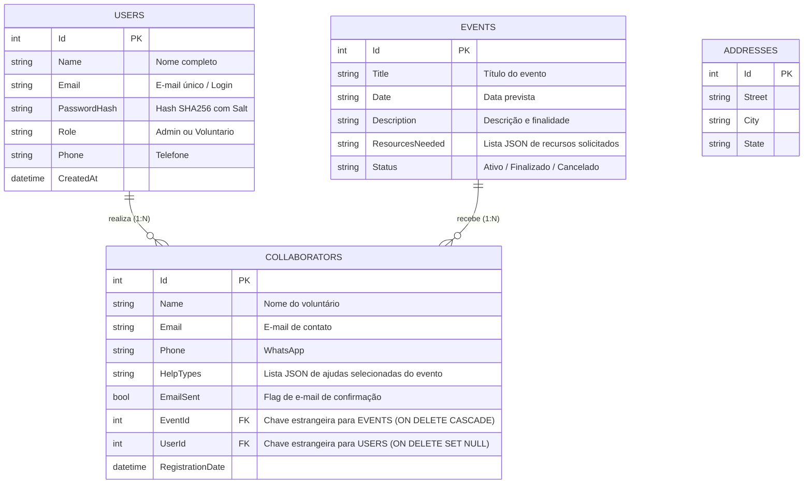

# 🤝 Portal Elo APAE - Gestão de Eventos e Voluntariado

> **Trabalho da Disciplina:** Prática IV  
> **Instituição:** Universidade do Oeste de Santa Catarina (UNOESC)  
> **Professor Orientador:** Maurício Gonzatto  
> **Organização Atendida:** APAE (Associação de Pais e Amigos dos Excepcionais)  

---

## 📌 1. Sobre o Projeto

O **Portal Elo APAE** é uma plataforma web completa desenvolvida em **C# / ASP.NET Core MVC (.NET 10)** com persistência relacional em banco de dados **MySQL**. A aplicação conecta a comunidade aos projetos da APAE através de:

1. **Gestão Inteligente de Eventos e Recursos:** O administrador cadastra eventos beneficentes e define detalhadamente quais **recursos e tipos de ajuda específicos** aquele evento necessita (mão de obra, alimentos, PIX/financeiro, materiais de limpeza, doações de roupas, itens personalizados, etc.).
2. **Inscrição Vinculada de Voluntários:** Ao se voluntariar para um evento específico, o voluntário visualiza e seleciona **exatamente as necessidades cadastradas para aquele evento**, eliminando opções genéricas ou desconexas.
3. **Autenticação e Perfis de Acesso (RBAC):**
   - **Administrador:** Acesso irrestrito a todas as funções — Início, Eventos Solidários, Gestão de Eventos (criar, editar, excluir), Gestão de Voluntários (listagem geral, filtros avançados, disparo de e-mails em lote ou individual) e Painel Administrativo.
   - **Voluntários / Usuários:** Podem se cadastrar, fazer login, navegar pelos eventos solidários, se inscrever com dados pré-preenchidos e **visualizar/acompanhar suas inscrições feitas** com status de confirmação e opção de cancelamento.

---

## 🛠️ 2. Tecnologias Envolvidas

- **Linguagem:** C# 13 / .NET 10 (LTS Target)
- **Framework Web:** ASP.NET Core 10 MVC com Razor Views
- **Acesso a Dados (ORM):** Entity Framework Core 10 (`Microsoft.EntityFrameworkCore`)
- **Provedor de Banco de Dados:** `MySql.EntityFrameworkCore` (Driver oficial da Oracle para EF Core 10)
- **SGBD:** MySQL Server 8.0+ / MariaDB 10.5+
- **Segurança e Criptografia:** Hashing de senhas com SHA-256 e Salt criptográfico (`Infrastructure.Security.PasswordHasher`)
- **Autenticação:** Cookie Authentication nativo do ASP.NET Core com Claims e Roles (`Admin` e `Voluntario`)
- **Front-end:** HTML5, CSS3 Customizado (identidade visual APAE), Bootstrap 5, JavaScript Vanilla
- **Mensageria:** SMTP Client TLS (Google Gmail API)

---

## 📦 3. Bibliotecas e Versões (NuGet)

| Pacote NuGet | Versão | Projeto | Finalidade |
| :--- | :--- | :--- | :--- |
| **`Microsoft.EntityFrameworkCore`** | `10.0.12` | Repository / Web | ORM principal do Entity Framework Core |
| **`Microsoft.EntityFrameworkCore.Design`** | `10.0.12` | Repository | Suporte a ferramentas de design e scaffolding |
| **`Microsoft.EntityFrameworkCore.Tools`** | `10.0.12` | APAEApplication | Ferramentas do EF Core para CLI |
| **`MySql.EntityFrameworkCore`** | `10.0.12` | Repository / Web | Driver oficial Oracle MySQL para EF Core 10 |

---

## 📋 4. Pré-requisitos para Execução

1. **.NET 10 SDK** (ou Visual Studio 2022+ com suporte a .NET 10)
2. **MySQL Server 8.0+** (localmente ou via Docker)
3. **Git**

---

## 🚀 5. Como Configurar e Executar o Projeto

### Passo 1: Obter o Código
```bash
git clone <URL_DO_REPOSITORIO>
cd "Projeto APAE"
```

### Passo 2: Executar o MySQL

#### Opção A: Via Docker (Mais Rápido)
```bash
docker run --name apae-mysql -e MYSQL_ROOT_PASSWORD=root -e MYSQL_DATABASE=apae_db -p 3306:3306 -d mysql:8.0
```

#### Opção B: MySQL Local (Workbench, Wamp, XAMPP, etc.)
1. Inicie o serviço do MySQL na porta padrão `3306`.
2. A aplicação executa automaticamente `db.Database.EnsureCreated()` ao iniciar, criando o banco `apae_db`, todas as tabelas e o seed inicial de dados.
3. *(Opcional)* Se desejar criar via script SQL manual, execute o arquivo:  
   👉 `Docs/database_schema.sql`

---

### Passo 3: Configurar a Conexão
Edite o arquivo `APAEApplication/APAEApplication/appsettings.json`:
```json
{
  "ConnectionStrings": {
    "DefaultConnection": "Server=localhost;Port=3306;Database=apae_db;User=root;Password=SUA_SENHA;CharSet=utf8mb4;"
  },
  "SmtpSettings": {
    "Host": "smtp.gmail.com",
    "Port": 587,
    "Email": "seu_email@gmail.com",
    "Password": "sua_senha_de_app"
  }
}
```

---

### Passo 4: Compilar e Executar

Pelo terminal na pasta da solução:
```bash
cd APAEApplication
dotnet restore APAEApplication.slnx
dotnet build APAEApplication.slnx
dotnet run --project APAEApplication/APAEApplication.csproj
```

Abra no navegador o endereço indicado (ex: **`https://localhost:7147`**).

---

## 🔑 6. Contas de Acesso Padrão (Seed Data)

Para facilitar a correção e demonstração, o sistema já é inicializado com duas contas:

| Perfil | E-mail de Login | Senha | Acesso e Permissões |
| :--- | :--- | :--- | :--- |
| **Administrador** | `admin@apae.com.br` | `admin` | **Acesso Total:** Início, Eventos Solidários, Gestão de Eventos, Gestão de Voluntários e Disparo de E-mails em lote. |
| **Voluntário** | `voluntario@apae.com.br` | `123` | **Acesso de Usuário:** Início, Inscrição em Eventos Solidários e visualização de **Minhas Inscrições**. |

> Novos voluntários também podem se cadastrar a qualquer momento através do botão **"Cadastrar-se"** no topo da tela.

---

## 🎯 7. Vinculação Dinâmica: Cadastro de Evento vs. Cadastro de Voluntário

O sistema resolve a desconexão entre as necessidades do evento e as opções do voluntário:

```
[Administrador cria Evento] 
         │
         ▼ Cadastra recursos: ["Mão de obra", "Cestas básicas", "Doação PIX", "Brinquedos"]
         │
[Evento publicado no Portal]
         │
         ▼ Voluntário clica "Quero ser Voluntário"
         │
[Tela de Inscrição do Voluntário]
         │
         ▼ Carrega EXATAMENTE:
           ☑ Mão de obra
           ☑ Cestas básicas
           ☐ Doação PIX
           ☐ Brinquedos
         │
[Persistência no MySQL]
         ▼ Salva em Collaborators.HelpTypes vinculado ao EventId e UserId
```

---

## 🗄️ 8. Diagrama de Entidade e Relacionamento (DER)



---

## 📁 9. Estrutura de Pastas e Varredura Concluída

A varredura do repositório eliminou projetos duplicados/zumbis (`APAEApplication/Core`), submódulos aninhados fantasmas (`.git` interno) e arquivos de banco em memória legados (`MyData`), deixando apenas a estrutura essencial:

```
Projeto APAE/
├── .gitignore                         # Regras de exclusão Git (binários, .env, dlls, etc.)
├── README.md                          # Este documento oficial
├── Docs/                              # Pasta de documentação solicitada pelo professor
│   ├── Architecture.md                # Arquitetura detalhada do sistema
│   ├── ArchitectureDiagram.md         # Diagramas de blocos e sequência
│   ├── database_schema.sql            # Script SQL MySQL completo
│   └── PORTAL ELO APAE.pdf            # Especificação original do trabalho
└── APAEApplication/                   # Solução .NET
    ├── APAEApplication.slnx           # Arquivo da Solution
    ├── APAEApplication/               # Projeto Web ASP.NET Core 10 MVC
    │   ├── Controllers/               # Account, Admin, Event, Collaborator, Home
    │   ├── Services/                  # EmailService (SMTP TLS)
    │   ├── Views/                     # Views Razor (Login, Register, Eventos, Voluntários, etc.)
    │   ├── appsettings.json           # Configuração de banco e SMTP
    │   └── appsettings.Example.json   # Template sem segredos
    ├── Biblioteca/                    # Enums compartilhados (EventStatus, HelpType)
    ├── Model/                         # Entidades de Domínio (User, Event, Collaborator, Address)
    └── Repository/                    # DbContext, Repositórios e utilitário PasswordHasher
```

---

## 🛡️ 10. Segurança e Qualidade de Código

1. **Broken Access Control Mitigado:** Uso de `[Authorize(Roles = "Admin")]` nos métodos de gestão de eventos e voluntários. Usuários comuns só acessam eventos públicos e suas próprias inscrições.
2. **Proteção Anti-CSRF:** Atributo `[ValidateAntiForgeryToken]` em todos os formulários `POST`.
3. **Senhas Seguras:** Hashing via SHA-256 com Salt criptográfico isolado em `PasswordHasher`.
4. **Isolamento de Segredos:** Senhas e arquivos `.env` protegidos pelo `.gitignore`.
